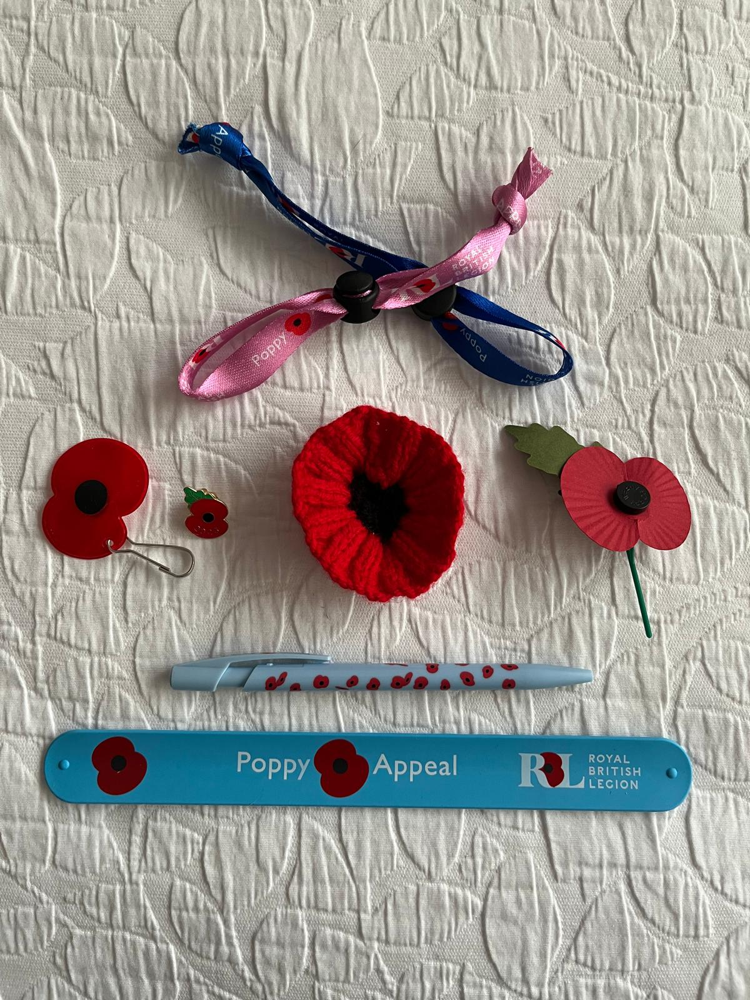

# Poppy Appeal 2026

This year's Poppy Appeal is about to be officially launched and from
this weekend our team of Souldern collectors - Elizabeth, Rebecca,
Sarah and Simone - will be visiting homes around the village with an
imaginative range of commemorative poppy items. You will also be able
to get them at the Fox.

In addition to the popular metal lapel badges there's eye catching
knitted poppies, wrist bands which come in the form of attractive
ribbons and ones that snap open to form a useful ruler, pens, wooden
crosses and of course the traditional paper poppies.  Cash is cool but
donations can also be made by scanning the QR code on the collecting
tin with your smartphone.

There's something for all the family and the funds raised go to the
Royal British Legion which does such great work supporting men and
women who have served their country and are now suffering from
physical or mental health issues.

-----

You may also donate to this year's poppy appeal by scanning the
QR code below which will take you to the Royal British Legion
Secure Donation Page, where you may donate via a credit or debit code or via Google Pay.

