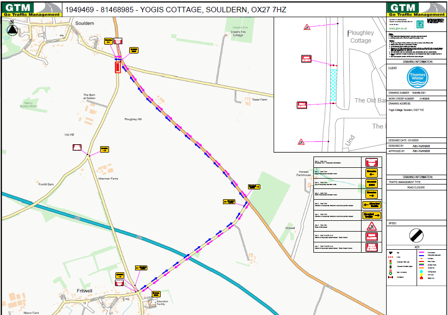

# TEMPORARY TRAFFIC REGULATION ORDER
## ROAD TRAFFIC REGULATION ACT, 1984

Notice is hereby given that Oxfordshire County Council, in exercise of
its powers under Section 14(1) of the Road Traffic Regulation Act
1984, intends to make a Temporary Traffic Regulation Order as detailed

below:

### Nature of Restriction: Road Closure

Location: Somerton Road, Souldern, Oxfordshire

Description of Works: New Water Connection and Potential Disconnection being carried out by Network Plus.

TTRO reference: 1324

Duration: **Starting on 05/01/2027 00:00**

The anticipated completion date is **09/01/2027 23:59** (inclusive)

(Temporary Traffic Regulation Orders have a maximum duration of 18 months for roads, or 6 months for other public rights of way).

Access: Access will be maintained for emergency service vehicles and for properties within the closed section of road where reasonably practicable.

Suggested Alternative Route: Via The Hill, Street From Souldern To Aynho, Street From Souldern To Baynards Green, East Street, Street Heading North West Out Of Fritwell and Vice Versa.

---

Further information regarding the works may be obtained by contacting Go traffic management on 07930356237 or by email lee.garrett@networkplus.co.uk .

Network Co-ordination

Oxfordshire County Council

Ron Groves House, Oxford Road, Kidlington, Oxfordshire, OX5 2BP

